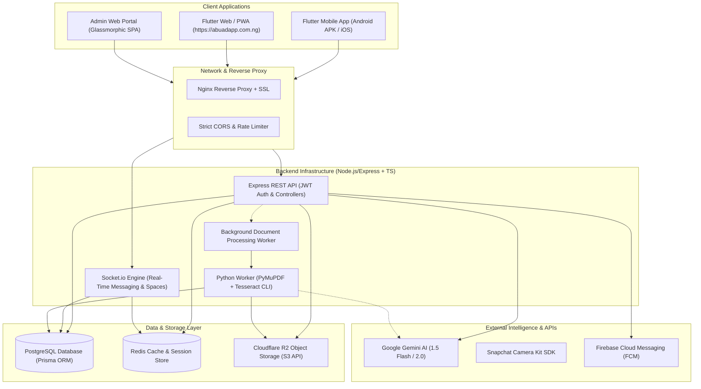
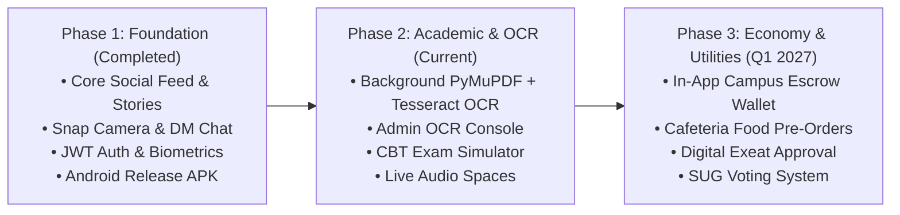

# 📄 Product Requirements Document (PRD): ABUAD Life (ABUAD App)

---

## 1. Executive Summary & Vision

### 1.1 Product Vision
**ABUAD Life** is the unified digital campus operating system for **Afe Babalola University, Ado-Ekiti (ABUAD)**. It bridges the gap between social engagement, academic productivity, campus commerce, real-time safety, and administrative workflows into a single high-performance cross-platform application (Android, iOS, Web PWA) paired with an administrative control console.

### 1.2 Problem Statement
Campus life at ABUAD suffers from extreme fragmentation:
1. **Academic Material Silos**: Lecture slides, past questions, and handouts are scattered across ad-hoc WhatsApp groups, lost in personal drives, or unreadable because they are low-quality scanned photocopies.
2. **Disconnected Campus Commerce**: Students buying and selling textbooks, gadgets, and hostel provisions rely on flooded group chats without trust, storefronts, or structured search.
3. **Fragmented Communication**: Official department announcements, social stories, and peer-to-peer chats conflict across different commercial social platforms without campus context.
4. **Safety & Utilities Friction**: Critical needs like clinic wait times, hostel maintenance reporting, shuttle transit schedules, and emergency panic alarms lack real-time digital automation.

### 1.3 Strategic Solution
An integrated, student-first platform designed specifically for the unique ecosystem of ABUAD:
- **Snapchat-Style Social & Ephemeral Chat**: High-frequency communication with streak mechanics, snap camera filters, view-once media, and real-time audio rooms.
- **Academic AI Co-Pilot & OCR Pipeline**: Automated digitization of digital and scanned physical lecture notes using PyMuPDF + Tesseract OCR running on memory-efficient servers, powering Gemini-driven CBT exam simulations and 5.0 CGPA calculation.
- **Peer-to-Peer Student Marketplace**: Structured campus storefronts with universal sharing, WhatsApp integration, and buyer-seller trust verification.
- **Campus Safety & Utilities Matrix**: Emergency SOS location broadcasts, digital hostel logging, clinic tracking, and campus polls.

---

## 2. Target Personas & Stakeholders

| Persona | Role | Primary Needs | Key Features Used |
| :--- | :--- | :--- | :--- |
| **Freshers & Undergrads** | 100L – 500L Students | Accessing class materials, exam prep, connecting with peers, finding hostel gear. | Feed, Stories, CBT Practice, Course Library, GPA Calculator, Chat. |
| **Course Representatives** | Student Academic Reps | Distributing syllabus materials, posting course alerts, broadcasting deadlines. | Resource Upload, Department Announcements, Group Broadcasts. |
| **Student Entrepreneurs** | Campus Vendors | Selling food, clothes, electronics, and design/tech services on campus. | Marketplace Listings, Seller Storefronts, WhatsApp Deep Linking. |
| **Hostel Wardens / Safety Staff** | Campus Security & Admin | Monitoring safety alerts, verifying student status, broadcasting official alerts. | Admin Dashboard, Emergency SOS Feed, Broadcast System. |
| **Super Administrators** | Student Affairs & IT | Moderating content, managing user bans, auditing academic library and OCR. | Admin Portal, User Management, OCR Queue Monitor. |

---

## 3. System Architecture & Tech Stack

### Technology Matrix
- **Frontend**: Flutter 3.44.x, Dart 3.12.x, Riverpod 2.x, GoRouter, GoogleFonts, Toastification.
- **Backend**: Node.js v20.x, Express.js, TypeScript 5.x, Prisma ORM 6.x.
- **Database**: PostgreSQL with connection pooling and automated migration scripts.
- **Media & File Storage**: Cloudflare R2 (S3-compatible, zero egress costs).
- **Real-Time Communication**: Socket.io 4.x with WebRTC signaling for live audio spaces.
- **OCR & Computer Vision**: PyMuPDF (fitz) + Tesseract OCR engine (5.3+) running with stream-piped stdout and low memory allocation.
- **AI Engine**: Google Gemini API via official `@google/genai` and `google-genai` SDK.

---

## 4. Functional Modules & Requirements

### Module 1: Authentication, Identity & Student Profiles
- **JWT Architecture**: Dual-token strategy with short-lived access tokens (15m) and persistent refresh tokens (30d) stored in secure device storage (`SharedPreferences`).
- **Student Profile**:
  - Full Name, Matric / ID Number, Department, Level (100L - 500L), Faculty, Phone Number.
  - Verification badges: `Student`, `Course Rep`, `Alumni`, `Verified Vendor`, `Admin`.
  - Close friends list (`CloseFriend` model) for granular story and location visibility.
- **Digital Student ID Card**:
  - In-app rendered biometric-style identification card with holographic gradient, dynamic QR code linking to `https://abuadapp.com.ng/user/:id`.

### Module 2: Campus Feed, Short Video & Stories
- **Chronological & Trending Feed**:
  - Rich text posts, multiple high-res images, video posts, and poll attachments.
  - Pinned department announcements and sponsored campus ads (`SponsoredAdCard`).
  - Hashtag indexing (`#ABUAD`, `#Engineering`, `#LawDinner`) with dedicated discovery feeds.
- **ABUAD Reels**:
  - Full-screen vertical swipe short-form video player with audio track association and comments drawer.
- **Campus Stories**:
  - 24-hour expiring media reel with circle avatar previews, viewer analytics, and interactive direct reply.

### Module 3: Snapchat-Style Camera & Real-Time Chat
- **Snapchat Camera Kit Integration**:
  - Live AR lenses, color grading, face smoothing, and quick text/drawing overlays.
- **Real-Time Messaging**:
  - 1-on-1 direct messaging and departmental group channels.
  - Ephemeral "View Once / Timer" snaps with automated server-side expiration.
  - **Snap Status Indicators**: Solid red arrowhead `➤ Delivered` / `Delivered · just now` matching modern Snapchat design guidelines.
  - Voice notes with live audio waveform scrubbing and on-demand transcriptions.
  - Interactive Streaks: Daily exchange counter with fire tier icons (`🔥 15`) and auto-expiry countdowns.

### Module 4: Live Audio Spaces ("ABUAD Spaces")
- **Live Drop-In Audio**:
  - Real-time Clubhouse/Twitter Spaces equivalent powered by WebRTC mesh and Socket.io signaling.
  - Role hierarchy: Host, Co-Host, Speaker, Listener.
  - Hand raising queue, speaker mute controls, audience reaction emojis, and pinned course links.
  - Universal share links (`https://api.abuadapp.com.ng/share/spaces/:id`) with instant rich OpenGraph preview cards for WhatsApp and Twitter.

### Module 5: Academic Companion, OCR & CBT Practice Engine
- **Resource Repository**:
  - Categorized lecture notes, syllabi, past examination papers, and laboratory manuals filtered by Faculty, Department, and Course Code.
- **Automated Background OCR Worker**:
  - Dual extraction: Digital text streams extracted directly via PyMuPDF; scanned physical pages processed sequentially via Tesseract OCR at 300 DPI.
  - Low-memory guarantee: Built to process multi-page documents safely on memory-constrained servers (512MB RAM VPS) using swap buffer streaming.
- **CBT Examination Generator & Simulator**:
  - Ingests OCR-extracted course text into Gemini to generate realistic multiple-choice CBT questions (ABUAD format: 4 options, timed countdown, instant grading, and detailed explanations).
- **Academic Utilities**:
  - 5.0 CGPA Calculator and Target Simulator.
  - Exam Countdown widget with push notifications.
  - Daily Lecture Timetable with 15-minute advance alerts.
  - Attendance Tracker with target percentage threshold alerts.

### Module 6: Student Marketplace & Campus Gigs
- **Marketplace Listings**:
  - Buy/sell listings with price in Nigerian Naira (`₦`), high-resolution Cloudflare R2 photos, item condition (`Brand New`, `Like New`, `Fair`), and location tag (Hostel block or campus cafeteria).
  - WhatsApp direct integration ("Chat with Seller on WhatsApp" pre-populated with listing URL).
- **Student Gigs**:
  - Freelance campus work: Laundry assistance, room cleaning, graphic design, laptop repairs, and assignment tutoring.

### Module 7: Campus Safety & Daily Utilities
- **Emergency SOS Alarm**:
  - One-tap panic trigger dispatching live GPS coordinates to campus security and emergency contacts.
- **Hostel Hub**:
  - Hostel repair ticketing (plumbing, electrical, bed frame) with administrative resolution status (`Reported`, `Assigned`, `Fixed`).
- **Clinic Queue Tracker**:
  - Live queue counter at ABUAD University Health Center to prevent crowded waiting halls.
- **Shuttle Board**:
  - Real-time campus shuttle route tracker (Main Gate $\leftrightarrow$ Law $\leftrightarrow$ Engineering $\leftrightarrow$ Medical College).
- **Lost & Found Feed**:
  - Community board for lost matric cards, vehicle keys, and laptops with verified return verification.

### Module 8: Super Admin & Operations Portal
- **Dashboard & User Moderation**:
  - Real-time platform metrics, user verification approval, ban/unban enforcement.
- **Academic Resource & OCR Console**:
  - Live monitoring of pending, extracting, OCR running, and failed document queues.
  - One-click bulk reprocessing (`/resources/process-all-pending?includeFailed=true`) and inline extracted text inspection modal.
- **Campus Broadcast Alerts**:
  - Instant platform-wide banners and priority push notifications to all registered students.

---

## 5. Non-Functional Requirements (NFRs)

### 5.1 Performance & Speed
- **App Launch & Splash Dismissal**: Flutter native splash screen must dismiss in under 400ms on Android 12+ using `setOnExitAnimationListener`.
- **API Response Time**: 95% of non-analytical REST endpoints must respond within $\le 120\text{ms}$.
- **Real-Time Latency**: Socket.io message transmission and typing indicators must complete within $\le 80\text{ms}$ under standard 4G/Wi-Fi conditions.

### 5.2 Server Resource Constraints
- **Memory Footprint**: Node.js backend + PM2 must maintain a baseline RSS of $\le 160\text{MB}$.
- **OCR Resource Isolation**: PyMuPDF + Tesseract subprocesses must never spawn concurrently on a 1 vCPU / 512MB RAM instance; jobs are queued sequentially and run with single-thread process limits (`OMP_THREAD_LIMIT=1`).

### 5.3 Reliability & Offline Resilience
- **Offline First**: The mobile client must cache the user profile, active chats, and the last 30 feed posts locally via `SharedPreferences` / `Hive` so the app is instantly usable without an internet connection.
- **Network Retry**: `ApiClient` employs a 3-tier exponential backoff retry mechanism with timeout caps (12s) to prevent frozen UI threads on unstable campus Wi-Fi.

### 5.4 Security & Compliance
- **Authentication**: Passwords hashed using bcrypt (cost factor 10); JWT tokens signed with SHA-256 HMAC secrets.
- **Media Protection**: Cloudflare R2 bucket configured with strict CORS rules and public read gateways restricted to authorized domains.
- **Student Privacy**: Ghost Mode available on campus map; phone numbers masked unless explicitly shared on marketplace listings.

---

## 6. Release Phases & Roadmap

---

## 7. Key Performance Indicators (KPIs)

1. **Daily Active Users (DAU) / Monthly Active Users (MAU)**: Target $\ge 65\%$ ratio within the ABUAD student population during semesters.
2. **Academic Engagement**: $\ge 15,000$ CBT practice questions solved and $\ge 2,500$ lecture notes accessed per exam cycle.
3. **Chat Velocity**: Average of $\ge 25$ messages sent per active user per day; $\ge 60\%$ 7-day snap streak retention.
4. **Marketplace Volume**: Over 1,000 active student listings per semester with an average time-to-sale $\le 4$ days.
5. **App Stability**: Crash-free sessions $\ge 99.4\%$ across Android and Web platforms.
