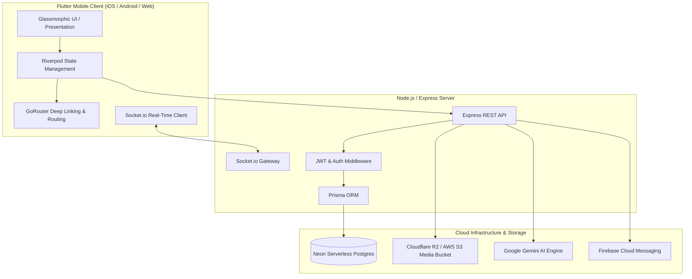

<div align="center">
  <!-- Official App Icon Badge -->
  <a href="https://abuadweb-aku5bf7wo-pikebuwa-gmailcoms-projeel.app">
    
  </a>

  <br/><br/>

  <!-- Animated Vector Banner -->
  <a href="https://abuadweb-aku5bf7wo-pikebuwa-gmailcoms-projeel.app">
    
  </a>

  <br/><br/>

  <!-- Dynamic Typing SVG Animation -->
  <a href="#">
    
  </a>

  <br/>

  [](https://flutter.dev)
  [](https://dart.dev)
  [](https://nodejs.org)
  [](https://neon.tech)
  [](https://prisma.io)
  [](https://socket.io)
  [](https://riverpod.dev)
  [](https://pub.dev/packages/go_router)
  [](https://shorebird.dev)
  [](https://abuadweb-aku5bf7wo-pikebuwa-gmailcoms-projeel.app)

  <br/><br/>

  <!-- Animated Tech Stack Icon Ribbon -->
  <a href="#">
    
  </a>
</div>

<!-- Animated Section Divider -->


## 🚀 Overview

**Abuad Life** is a next-generation, high-performance campus super app custom-engineered for the vibrant community of **Afe Babalola University (ABUAD)**. Designed from the ground up to replace fragmented campus portals, Abuad Life brings together dynamic social networking, immersive short-form video reels, pro-grade camera capture, real-time messaging with hands-free voice notes, AI campus assistance, student peer-to-peer commerce, and essential academic utilities into a unified, glassmorphic design system.

> [!IMPORTANT]
> **Built with a Zero-Compromise Premium Aesthetic** — featuring fluid 60fps micro-animations, Frosted Glassmorphism, tailored HSL color tokens, instant haptic feedback, and deep linking across the entire ecosystem.

---

## 📲 Download & Mobile Experience

<div align="center">
  
  
  <p><em>Experience ABUAD Life on iOS, Android, and the Web. Connect with verified students, explore campus culture, and access student services seamlessly.</em></p>

  <a href="https://abuadweb-aku5bf7wo-pikebuwa-gmailcoms-projeel.app">
    
  </a>
  &nbsp;
  <a href="https://abuadweb-aku5bf7wo-pikebuwa-gmailcoms-projeel.app">
    
  </a>
  &nbsp;
  <a href="https://abuadweb-aku5bf7wo-pikebuwa-gmailcoms-projeel.app">
    
  </a>
</div>

---

## ✨ Feature Highlights

<details open>
<summary><h3>📸 Pro Story & Media Camera</h3></summary>

- **Full-Bleed Viewfinder**: Custom aspect ratio engine guaranteeing edge-to-edge camera coverage without letterboxing or distortion across iOS & Android screens.
- **Precision Zoom System**: Smooth pinch-to-zoom gesture paired with quick-select zoom pills (`0.5x`, `1x`, `2x`, `3x`) on both front and rear sensors.
- **Lighting & Pro Controls**: Tap-to-focus with animated exposure ring & sun slider, dedicated Night Mode, torch/flash controls, and composition grids (Rule of Thirds, Golden Ratio, Crosshairs).
- **Creative Island Capsule**: 12-tool frosted right toolbar (Tuning, Flip, Timer, Night, Grid, Text `Aa`, Pen, Stickers, Scissors, Attachment link, Stopwatch).
- **Dual-Action Shutter Experience**: Iridescent glowing shutter button with dual-mode interaction (tap to snap, hold for video) and multi-mode carousel (`Directors Mode`, `Camera`, `Video`, `Night`, `Focus`).

</details>

<details open>
<summary><h3>🎙️ Ultra-Responsive Hands-Free Voice Notes</h3></summary>

- **Zero-Latency Touch**: Built with raw pointer tracking (`Listener`) providing immediate 0ms response and heavy haptic feedback upon touch down.
- **Swipe-Up-to-Lock**: Slide thumb upward while recording to lock into hands-free mode with an animated floating lock badge and live pulsing waveform.
- **Slide-to-Cancel**: Fluid horizontal swipe-left gesture with haptic cancellation and immediate audio cleanup.
- **Voice Message Playback**: Inline audio player with playback speed controls (`1x`, `1.5x`, `2x`), scrubbing, and duration counters.

</details>

<details open>
<summary><h3>🎬 Reels & Short Video Experience</h3></summary>

- **Immersive Reel Feed**: TikTok-style vertical pagination with pre-caching, auto-play, and seamless video looping.
- **Audio Track Engine**: Dedicated audio hub (`/audio-track`) linking reels by sound, showing waveforms, usage stats, and artist attribution.
- **Interactive Scrubber**: Floating time preview pill with precision scrubbing across long-form reels.
- **Multi-Heart Particle Burst**: Animated dual-tap heart burst reactions with physics bounce.

</details>

<details open>
<summary><h3>🌟 Live Media & Animated Avatars</h3></summary>

- **Animated Avatar & Banner Autoplay**: Support for live photos (`.mp4`, `.mov`, `.webm`) and animated `.gif` on user profiles and avatars.
- **Gapless Playback**: Intelligent media detector that mutes and loops live avatar clips seamlessly throughout feed comments, profile headers, and user cards.
- **Interactive Media Picker**: Modal options allowing users to upload traditional photos, high-resolution GIFs, or short live motion clips.

</details>

<details open>
<summary><h3>🛍️ Student P2P Marketplace & Social Sharing</h3></summary>

- **Campus Commerce Hub**: Buy and sell textbooks, electronics, dorm essentials, fashion, and gadgets with zero commission.
- **Instant Buyer-Seller Chat**: Dedicated in-app chat bridging listings with direct messaging, condition queries, and pricing negotiations.
- **Universal Marketplace Sharing**: One-tap native sharing via `share_plus` with formatted pricing (`₦`) and direct deep links (`https://abuadapp.com.ng/marketplace/detail?id=...`).
- **Deep Link Ingestion**: Seamless deep link resolution allowing non-app and app users to jump straight to product details.

</details>

<details>
<summary><h3>🗳️ Interactive Campus Polls</h3></summary>

- **Dynamic Duration Options**: Configure poll lifespans from `12 Hours`, `1 Day`, `3 Days`, `7 Days`, `14 Days`, `30 Days`, up to `No Limit (Permanent)`.
- **Change Vote Support**: Voters can dynamically change their vote by tapping an alternative choice, updating percentages and live tallies in real-time.
- **Campus Feedback**: Ideal for faculty elections, hall-of-residence decisions, academic course feedback, and student union surveys.

</details>

<details>
<summary><h3>👥 Group Chat Communities & Invitation Links</h3></summary>

- **Community Group Channels**: Departmental, faculty, and interest-based group chats with admin controls, member rosters, and announcement modes.
- **Universal Invitation Links**: Shareable group links (`https://abuadapp.com.ng/join/group/:channelId`).
- **Interactive Preview Screen**: Beautiful preview card showing group avatars, member counts, and quick "Join Group" or "Open Chat" buttons.
- **Robust Member Management**: Real-time member addition with instant loading states, feedback SnackBars, and flexible backend channel resolvers.

</details>

<details>
<summary><h3>📖 24-Hour Stories & Ephemeral Snaps</h3></summary>

- **Disappearing Media**: 24-hour video and photo stories with viewer tracking and completion rings around user avatars.
- **Frosted Glass Reply Bar**: Modern reply input bar with backdrop blur, glowing borders, emoji reactions, and gradient send button.
- **Mention Detection**: Tag `@handle` inside stories to enable direct profile navigation.

</details>

<details>
<summary><h3>🔖 Bookmark & Collections System</h3></summary>

- **Folder Organization**: Save posts and reels into custom collections (e.g., *Campus Events*, *Study Notes*, *Inspiration*).
- **Folder Picker Bottom Sheet**: Quick-add with one-tap folder creation and real-time counter updates.
- **Profile Filter Chips**: Fast categorization on user profile to review bookmarks by topic.

</details>

<details>
<summary><h3>🔍 Discovery, Search & Hashtag Hub</h3></summary>

- **Hashtag Hub Screen**: Dedicated hashtag landing pages (`/hashtag/:tag`) with aggregated media grids, post metrics, and tag follower counts.
- **Real-Time Autocomplete**: Instant search suggestions for `#hashtags`, `@user` mentions, and persistent search history.
- **People You May Know Carousel**: Sleek glassmorphic user recommendation cards with verified badges, department indicators, and one-tap follow buttons.

</details>

<details>
<summary><h3>✍️ Rich Markdown & AI Assistance</h3></summary>

- **Composer Formatting Toolbar**: Quick-action markdown bar for posts, comments, and chat (`Bold`, `Italic`, `Links`, `Code`, `@Mentions`, `#Tags`).
- **Live Markdown Preview**: Instant WYSIWYG toggle between editor and rendered output before publishing.
- **Campus AI Auto-Replies**: Tag `@ai` or `@abuad_ai` anywhere to trigger real-time smart campus answers, summaries, and academic assistance powered by Google Gemini.

</details>

<details>
<summary><h3>🛡️ Comprehensive Admin & Moderation Dashboard</h3></summary>

- **Global Advertisement Controls**: One-click kill switches for all platform advertisements, promotion banners, and sponsored posts.
- **Content Moderation**: Review reported posts, suspend offending accounts, and broadcast critical emergency announcements.
- **Metrics & Analytics**: Track daily active users, message throughput, marketplace GMV, and storage metrics.

</details>

---

## 🛠️ Architecture & System Design



### Tech Stack Breakdown

| Layer | Technologies | Purpose |
| :--- | :--- | :--- |
| **Mobile Client** | [Flutter](https://flutter.dev) 3.10.7+ • [Dart](https://dart.dev) 3.0+ | Cross-platform client for iOS, Android, and Web |
| **State Management** | [Flutter Riverpod](https://riverpod.dev) 3.0+ | Compile-safe reactive state management & DI |
| **Routing** | [GoRouter](https://pub.dev/packages/go_router) 17.0+ | Declarative routing, query params, and universal deep links |
| **Backend API** | [Node.js](https://nodejs.org) • [Express](https://expressjs.com) • [TypeScript](https://www.typescriptlang.org) | RESTful services, middleware, authentication & webhooks |
| **Database** | [Neon Postgres](https://neon.tech) • [Prisma ORM](https://prisma.io) | Serverless relational database with migration tracking |
| **Real-Time Sockets** | [Socket.io](https://socket.io) 4.8+ | Sub-50ms instant messaging, live typing, and online status |
| **Object Storage** | [Cloudflare R2](https://www.cloudflare.com/developer-platform/r2/) / [AWS S3](https://aws.amazon.com/s3/) | Media assets, voice notes, story videos, and image caching |
| **AI Integration** | [Google GenAI SDK](https://ai.google.dev/) (Gemini Flash) | Smart campus Q&A, query summarization, and moderation |
| **Hot Code Push** | [Shorebird](https://shorebird.dev) | Instant OTA code push without app store submission delays |
| **UI Aesthetics** | [Flutter Animate](https://pub.dev/packages/flutter_animate) • Custom Glassmorphism | 60fps micro-interactions, spring physics, and blur layers |

---

## 📂 Project Directory Structure

```text
abuad/
├── assets/                          # Static branding, vectors, and imagery
│   ├── images/
│   │   ├── app_icon.png             # Official App Icon
│   │   ├── dowloadappimage.jpeg     # Download & Promo Banner
│   │   ├── header_animation.svg     # Animated vector banner
│   │   └── splash_padded.png        # Launch splash screen
├── backend/                         # Node.js + TypeScript + Express backend
│   ├── prisma/
│   │   └── schema.prisma            # Database schema & entity definitions
│   ├── src/
│   │   ├── index.ts                 # Server entrypoint & Socket.io setup
│   │   ├── middleware/              # Auth, rate limiting & error handling
│   │   └── routes/                  # Express controllers & API endpoints
│   │       ├── admin.ts             # Admin dashboard, config & kill-switches
│   │       ├── ai.ts                # Gemini AI campus assistance
│   │       ├── auth.ts              # Authentication & password management
│   │       ├── chat.ts              # Channels, DMs, group invites, voice notes
│   │       ├── marketplace.ts       # Products, categories & listings
│   │       ├── posts.ts             # Feed, reels, likes, comments & polls
│   │       ├── stories.ts           # 24h stories & ephemeral snaps
│   │       └── users.ts             # Profiles, live avatars & followers
│   └── package.json                 # Backend scripts and dependencies
├── lib/                             # Flutter frontend source code
│   ├── main.dart                    # App entrypoint & ProviderScope initialization
│   └── src/
│       ├── core/                    # Core themes, routing, services & utilities
│       │   ├── router/              # AppRouter configuration & deep link handlers
│       │   ├── services/            # Audio, image upload, socket & notifications
│       │   └── theme/               # AppColors, AppTheme & typography
│       ├── features/                # Domain-driven feature modules
│       │   ├── advertisements/      # Sponsored ads & moderation toggles
│       │   ├── auth/                # Login, registration, OTP verification
│       │   ├── camera/              # Pro camera viewfinder, overlays & zoom engine
│       │   ├── chat/                # Real-time chat, voice notes & join screens
│       │   ├── feed/                # Feed posts, reels, audio hubs & polls
│       │   ├── map/                 # Campus landmarks & navigational guide
│       │   ├── marketplace/         # Student marketplace & listing details
│       │   ├── profile/             # User profile, live photo avatars & settings
│       │   ├── stories/             # Story viewer, snap creator & reply bar
│       │   └── utilities/           # Campus polls, GPA tools, academic schedule
│       └── shared/                  # Reusable UI components & widgets
│           └── widgets/
│               ├── autoplay_live_media_widget.dart  # Looping video/GIF renderer
│               ├── user_avatar.dart                 # Avatar with story rings & live media
│               └── abuad_markdown.dart              # Custom markdown renderer
└── pubspec.yaml                     # Flutter package dependencies & assets
```

---

## ⚡ Getting Started

### 1. Prerequisites

- **Flutter SDK**: `v3.10.7` or higher (`flutter --version`)
- **Node.js**: `v18.0.0` or higher (`node --version`)
- **Package Managers**: `npm` / `pnpm` and `uv` (for Python tools)
- **Database**: PostgreSQL connection URI (e.g. Neon, Supabase, or local Postgres)
- **Platform Tools**: Android Studio (with Android SDK) or Xcode (macOS)

---

### 2. Backend Setup (`backend/`)

```bash
# 1. Navigate to the backend directory
cd backend

# 2. Install dependencies
npm install

# 3. Configure environment variables (.env)
cp .env.example .env # Or create .env with your DATABASE_URL, JWT_SECRET, etc.

# 4. Generate Prisma Client and sync schema
npx prisma generate
npx prisma db push

# 5. Start the development server
npm run dev
```

*The backend server will start on `http://localhost:5000` (or your configured `PORT`) with real-time WebSockets active.*

---

### 3. Mobile Frontend Setup (`abuad/`)

```bash
# 1. Navigate to the root directory
cd ../

# 2. Install Flutter packages
flutter pub get

# 3. Generate models & serialization code
flutter pub run build_runner build --delete-conflicting-outputs

# 4. Verify system diagnostics
flutter doctor

# 5. Run the application
flutter run
```

---

## 🔗 Deep Linking & URL Schemes

Abuad Life supports universal and custom scheme deep linking across platforms:

| Link Pattern | Destination | Description |
| :--- | :--- | :--- |
| `https://abuadapp.com.ng/marketplace/detail?id=:id` | `MarketplaceDetailScreen` | Direct link to buy/sell listing |
| `https://abuadapp.com.ng/join/group/:channelId` | `JoinGroupScreen` | Invitation preview card & join action |
| `https://abuadapp.com.ng/user/:userId` | `ProfileScreen` | Direct student profile view |
| `https://abuadapp.com.ng/hashtag/:tag` | `HashtagScreen` | Aggregated hashtag media feed |
| `abuad://open` | `MainNavigationScreen` | Default scheme launch |

---

## 🗄️ Database Architecture

The backend database runs on **Neon Serverless PostgreSQL** managed via **Prisma ORM**:

- **`User`**: Account identity, handles, verified badges, live avatars, department, and bio.
- **`Post` & `Reel`**: Short-form videos, photos, poll references, audio track links, and captions.
- **`Channel` & `Message`**: 1-on-1 and group chats, voice note URLs, reactions, and attachments.
- **`MarketplaceItem`**: Listings, pricing, condition, image galleries, and seller links.
- **`Story`**: 24-hour expiring media with viewer tracking.
- **`Poll` & `PollOption`**: Multiple-choice campus polls with dynamic vote switching and expirations.

---

<!-- Animated Footer Wave -->


<div align="center">
  <p><strong>© 2026 ABUAD App Team • Built with ❤️ for Afe Babalola University</strong></p>
  <p><sub>All Rights Reserved. Engineered with Flutter, Node.js, and Neon Postgres.</sub></p>
</div>
