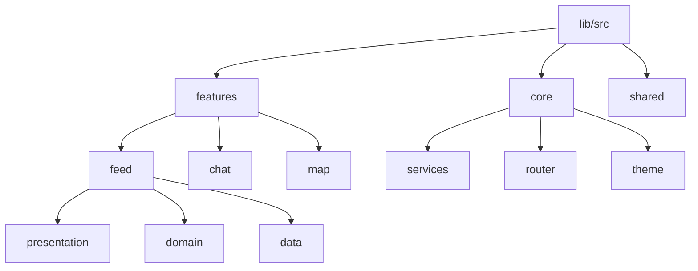

<div align="center">
  
  <h1>ABUAD NEST</h1>
  <p><strong>The Elite Campus Super App for Afe Babalola University</strong></p>

  [](https://flutter.dev)
  [](https://firebase.google.com)
  [](https://riverpod.dev)
  [](LICENSE)
</div>

---

## 🚀 Overview

**ABUAD Nest** is a high-performance, feature-rich campus ecosystem designed to centralize and elevate the student experience at Afe Babalola University. From immersive social discovery to real-time communication and essential academic utilities, ABUAD Nest is the digital backbone of campus life.

> [!IMPORTANT]
> This application is built with a **Premium UI/UX** philosophy, utilizing glassmorphism, advanced animations, and high-fidelity design tokens to deliver a "WOW" factor at every interaction.

---

## ✨ Feature Galaxy

### 📱 Social & Discovery
- **Discovery Hub**: A functional search engine for finding trending hashtags, students, and content.
- **Dynamic Feed**: Real-time media sharing with TikTok-style immersion, likes, and nested comments.
- **Stories & Reels**: Vertical video and transient story support with high-fidelity capture.
- **Premium Profiles**: Customizable user identities with verification badges (👑 Gold, 🎓 Student).

### 💬 Communication
- **Real-time Chat**: High-performance DMs and group channels with read receipts and media sharing.
- **Broadcast Hub**: Departmental or interest-based one-to-many communication channels.
- **QR Engine**: Instant student profile sharing and verification via mobile scanning.

### 🏛️ Campus & Utility
- **Campus Map**: Intelligent geolocation and landmark discovery across the ABUAD landscape.
- **Marketplace**: P2P campus commerce for students to buy and sell securely.
- **Academic Portal**: Centralized access to school results, newsletters, and departmental resources.
- **Events & Groups**: Discovering and joining campus organizations and upcoming festivals.

---

## 🛠️ Technology Stack

| Category | Technology |
| :--- | :--- |
| **Framework** | [Flutter](https://flutter.dev) (v3.10.7+) |
| **State Management** | [Riverpod](https://riverpod.dev) (Notifier & AsyncValue patterns) |
| **Backend** | [Firebase](https://firebase.google.com) (Firestore, Auth, Storage, Messaging) |
| **Navigation** | [GoRouter](https://pub.dev/packages/go_router) (Declarative & Shell Routing) |
| **Performance** | [Shorebird](https://shorebird.dev) (OTA Hot Push updates) |
| **Animations** | [Flutter Animate](https://pub.dev/packages/flutter_animate) & Shimmer |

---

## 🏗️ Architectural Blueprint

The application follows a **Feature-First Clean Architecture** to ensure massive scalability and maintainability.



- **Presentation**: UI components, Notifiers, and Screen-specific widgets.
- **Domain**: Pure Dart models and business logic entities.
- **Data**: Repositories, API services, and DTOs.

---

## 🛠️ Developer Guide

### Prerequisites
- Flutter SDK (Channel Stable)
- Firebase CLI (`npm install -g firebase-tools`)
- CocoaPods (for iOS builds)

### Quick Start
1. **Clone & Install**:
   ```bash
   git clone https://github.com/Egcasy/abuad.git
   flutter pub get
   ```
2. **Generate Code**:
   ```bash
   flutter pub run build_runner build --delete-conflicting-outputs
   ```
3. **Run Design System Check**:
   Ensure your theme tokens are synced with `AppColors` and `AppTheme`.

---

## 📝 Firestore Index Troubleshooting

If you encounter `[cloud_firestore/failed-precondition]` errors, follow this protocol:

1. **Deploy Missing Indexes**:
   ```bash
   firebase deploy --only firestore:indexes
   ```
2. **Key Critical Indexes**:
   - `channels`: `member_ids` (array-contains) + `last_message_time` (descending)
   - `posts`: `hashtags` (array-contains) + `created_at` (descending)

---

<div align="center">
  <p>© 2026 ABUAD App Team. Built with ❤️ for Afe Babalola University.</p>
</div>
