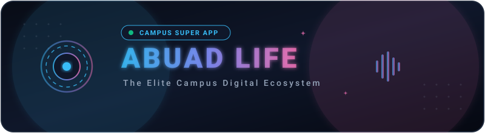
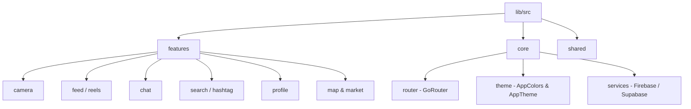

<div align="center">
  <!-- Animated Vector Banner -->
  <a href="https://abuadweb-aku5bf7wo-pikebuwa-gmailcoms-projeel.app">
    
  </a>

  <br/><br/>

  <!-- Dynamic Typing SVG Animation -->
  <a href="#">
    
  </a>

  <br/>

  [](https://flutter.dev)
  [](https://firebase.google.com)
  [](https://riverpod.dev)
  [](https://pub.dev/packages/go_router)
  [](https://shorebird.dev)
  [](https://abuadweb-aku5bf7wo-pikebuwa-gmailcoms-projeel.app)

  <br/><br/>

  <!-- Animated Tech Stack Icon Ribbon -->
  <a href="#">
    
  </a>
</div>

<!-- Animated Section Divider -->


## 🚀 Overview

**Abuad Life** is a modern, high-performance campus super app designed to streamline, connect, and elevate student life at Afe Babalola University (ABUAD). Bringing together dynamic social networking, short-form video reels, pro-grade camera capture, real-time messaging, AI campus assistance, and essential academic utilities into a unified, glassmorphic design system.

> [!IMPORTANT]
> Built with an uncompromising **Premium UI/UX Philosophy** — utilizing fluid micro-animations, Frosted Glassmorphism, tailored HSL color tokens, and instant haptic feedback.

---

## ✨ Feature Highlights

<details open>
<summary><h3>📸 Pro Story & Media Camera</h3></summary>

- **Full-Bleed Viewfinder**: Custom aspect ratio engine guaranteeing edge-to-edge camera coverage without letterboxing or distortion.
- **Precision Zoom System**: Smooth pinch-to-zoom gesture paired with quick-select zoom pills (`0.5x`, `1x`, `2x`, `3x`) on both front and rear sensors.
- **Lighting & Pro Controls**: Tap-to-focus with animated exposure ring & sun slider, dedicated Night Mode, torch/flash controls, and composition grids (Rule of Thirds, Golden Ratio, Crosshairs).
- **Creative Island Capsule**: 12-tool frosted right toolbar (Tuning, Flip, Timer, Night, Grid, Text `Aa`, Pen, Stickers, Scissors, Attachment link, Stopwatch).
- **Shutter Experience**: Iridescent glowing shutter button with dual-mode interaction (tap to snap, hold for video) and multi-mode carousel (`Directors Mode`, `Camera`, `Video`, `Night`, `Focus`).

</details>

<details open>
<summary><h3>🎬 Reels & Short Video Experience</h3></summary>

- **Immersive Reel Feed**: TikTok-style vertical pagination with real-time audio playback.
- **Audio Track Engine**: Dedicated audio hub (`/audio-track`) linking reels by sound, showing waveforms, usage stats, and artist attribution.
- **Interactive Scrubber**: Floating time preview pill with precision scrubbing across long-form reels.
- **Multi-Heart Particle Burst**: Animated dual-tap heart burst reactions with physics bounce.

</details>

<details open>
<summary><h3>🔖 Bookmark & Collections System</h3></summary>

- **Folder Organization**: Save posts and reels into custom collections (e.g., *Campus Events*, *Study Notes*, *Inspiration*).
- **Folder Picker Bottom Sheet**: Quick-add with one-tap folder creation and real-time counter updates.
- **Profile Filter Chips**: Fast categorization on user profile to review bookmarks by topic.

</details>

<details>
<summary><h3>🔍 Discovery, Search & Hashtag Hub</h3></summary>

- **Hashtag Hub Screen**: Dedicated hashtag landing pages (`/hashtag/:tag`) with aggregated media grids, post metrics, and tag follower counts.
- **Real-Time Autocomplete**: Instant search suggestions for `#hashtags`, `@user` mentions, and persistent search history.

</details>

<details>
<summary><h3>✍️ Rich Markdown & AI Assistance</h3></summary>

- **Composer Formatting Toolbar**: Quick-action markdown bar for posts, comments, and chat (`Bold`, `Italic`, `Links`, `Code`, `@Mentions`, `#Tags`).
- **Live Markdown Preview**: Instant WYSIWYG toggle between editor and rendered output before publishing.
- **Campus AI Auto-Replies**: Tag `@ai` or `@abuad_ai` anywhere to trigger real-time smart campus answers, summaries, and academic assistance.

</details>

<details>
<summary><h3>💬 Real-Time Messaging & Broadcasts</h3></summary>

- **Direct & Group Chats**: Instant messaging with typing indicators, delivery/read receipts, voice notes, and media attachments.
- **Departmental Broadcasts**: One-to-many official announcements with verified faculty badges.
- **QR Profile Engine**: Instant identity sharing and verification via mobile QR code scanning.

</details>

<details>
<summary><h3>🏛️ Campus Ecosystem Utilities</h3></summary>

- **Campus Map & Landmark Explorer**: Interactive points of interest across the ABUAD landscape.
- **Student P2P Marketplace**: Secure campus commerce for electronics, textbooks, and hostel essentials.
- **Academic Portal**: Quick access to results, academic calendars, and departmental notices.

</details>

---

## 🛠️ Architecture & Tech Stack



| Category | Technology | Purpose |
| :--- | :--- | :--- |
| **Framework** | [Flutter](https://flutter.dev) (v3.10.7+) | Cross-platform client (iOS & Android) |
| **State Management** | [Riverpod](https://riverpod.dev) | Reactive, testable state & dependency injection |
| **Navigation** | [GoRouter](https://pub.dev/packages/go_router) | Declarative routing with deep links & shell routes |
| **Backend** | [Firebase](https://firebase.google.com) | Authentication, Firestore, Cloud Storage, Push Notifications |
| **Database & Auth** | [Supabase](https://supabase.com) / [Neon](https://neon.tech) | Scalable Postgres & relational data services |
| **OTA Updates** | [Shorebird](https://shorebird.dev) | Instant hot code push without app store review delays |
| **Animations** | [Flutter Animate](https://pub.dev/packages/flutter_animate) | Fluid 60fps micro-animations and physics transitions |

---

## 📂 Project Directory Structure

```text
abuad/
├── assets/                     # App icons, vectors, and brand assets
│   └── images/
│       └── header_animation.svg # Animated SVG header banner
├── lib/
│   ├── main.dart               # App entrypoint & provider scope
│   └── src/
│       ├── core/               # Theme, routing, network client, utilities
│       │   ├── router/         # AppRouter & deep-link configurations
│       │   └── theme/          # AppColors, typography, glassmorphism styles
│       ├── features/           # Feature-first modular architecture
│       │   ├── auth/           # Login, signup, password recovery
│       │   ├── camera/         # Pro camera viewfinder, overlays, zoom & filters
│       │   ├── chat/           # 1-on-1 & group chats, voice notes, attachments
│       │   ├── feed/           # Posts, reels, audio tracks, comments, bookmarking
│       │   ├── map/            # Interactive campus landmarks and navigation
│       │   ├── marketplace/    # Student buy & sell marketplace
│       │   ├── profile/        # User profiles, verification badges, saved folders
│       │   └── search/         # Search engine, autocomplete, hashtag hub
│       └── shared/             # Reusable UI widgets, buttons, dialogs, bottom sheets
└── test/                       # Unit and widget test suite
```

---

## 🚀 Getting Started

### Prerequisites

- [Flutter SDK](https://docs.flutter.dev/get-started/install) (v3.10.7+ or higher)
- [Dart SDK](https://dart.dev/get-dart)
- [Firebase CLI](https://firebase.google.com/docs/cli) (`npm install -g firebase-tools`)
- Android Studio / Xcode (with CocoaPods installed)

### Quick Setup

```bash
# 1. Clone the repository
git clone https://github.com/Egcasy/abuad.git
cd abuad

# 2. Install dependencies
flutter pub get

# 3. Generate models & serialization code
flutter pub run build_runner build --delete-conflicting-outputs

# 4. Launch on device / browser
flutter run
```

---

## 🗄️ Database & Firestore Indexes

If you encounter `[cloud_firestore/failed-precondition]` or missing index errors, deploy the project indexes:

```bash
firebase deploy --only firestore:indexes
```

---

<!-- Animated Footer Wave -->


<div align="center">
  <p><strong>© 2026 ABUAD App Team • Built with ❤️ for Afe Babalola University</strong></p>
  <p><sub>All Rights Reserved. Engineered with Flutter & Firebase.</sub></p>
</div>
